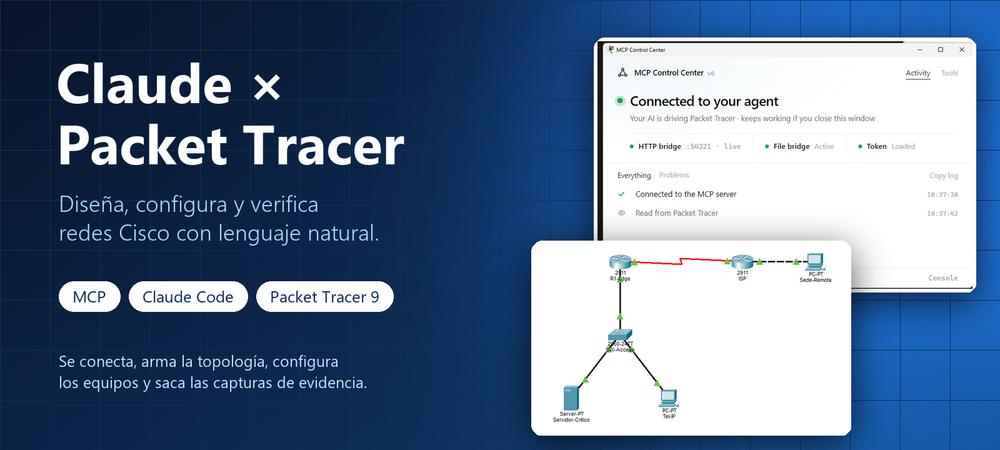
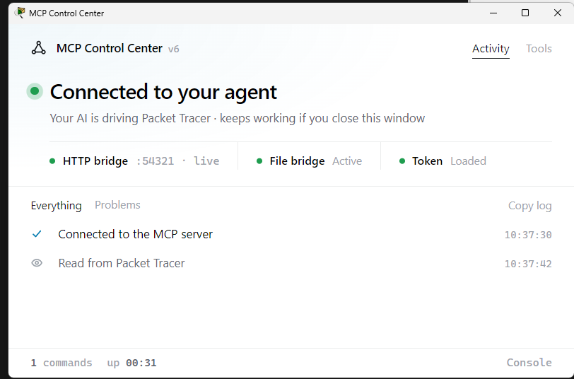
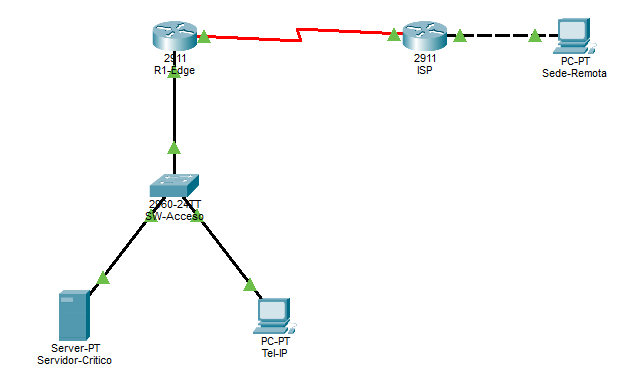
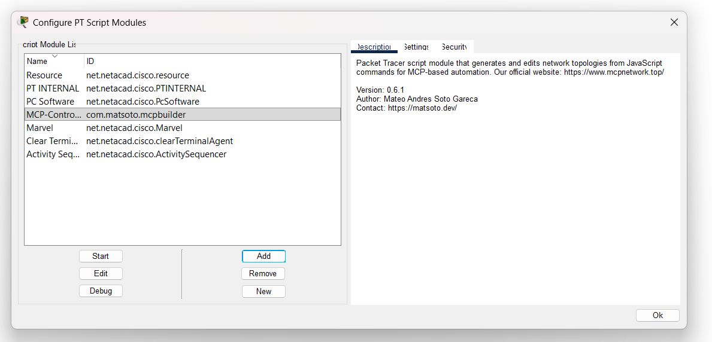
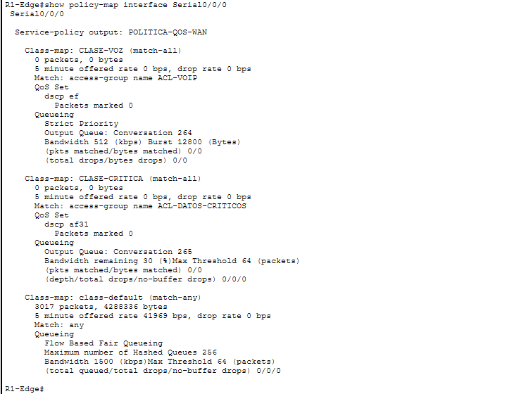
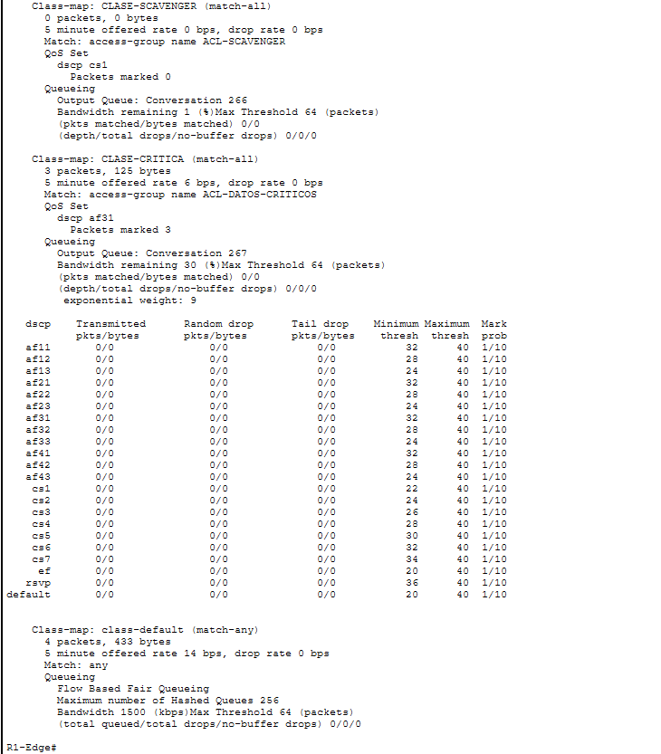
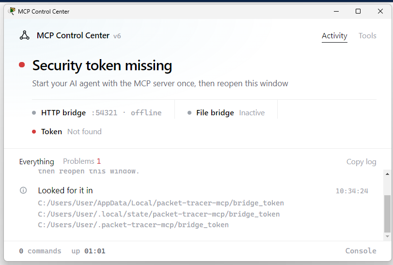

<p align="center">
  
</p>

<h1 align="center">Claude × Packet Tracer</h1>

<p align="center">
  <b>Diseña, configura y verifica redes Cisco hablando con una IA.</b><br>
  <i>Control Cisco Packet Tracer from Claude Code through MCP: build topologies, configure IOS and capture evidence with natural language.</i>
</p>

<p align="center">
  
  
  
  
</p>

---

## ¿Qué es esto?

Una guía **probada de principio a fin** para conectar **Claude Code** con **Cisco Packet Tracer** mediante un servidor MCP. Una vez conectado, le pides en español lo que quieres y la IA lo hace dentro del simulador:

> *"Arma un router de borde, un switch con dos VLAN, un servidor y una sede remota. Configura el enlace serial de 2 Mbps y verifica que haya conectividad."*

No es un simulador nuevo ni un servidor nuevo: es el **paso a paso real** (con las capturas, los errores que aparecen en Windows y cómo se resolvieron) para dejarlo funcionando, más un caso de estudio de QoS.

## Así se ve

<table>
  <tr>
    <td align="center" width="33%"><br><sub><b>1.</b> Packet Tracer conectado al agente</sub></td>
    <td align="center" width="33%"><br><sub><b>2.</b> Topología armada por la IA</sub></td>
    <td align="center" width="33%"><br><sub><b>3.</b> La extensión cargada en Packet Tracer</sub></td>
  </tr>
</table>

Y lo que la IA lee de los equipos para verificar su propio trabajo:

<table>
  <tr>
    <td align="center" width="50%"><br><sub>Contadores de QoS por clase, leídos del router</sub></td>
    <td align="center" width="50%"><br><sub>WRED por DSCP con sus umbrales</sub></td>
  </tr>
</table>

## Qué puede hacer

El servidor expone **unas 100 herramientas** a la IA. Las más útiles:

| Área | Ejemplos |
|---|---|
| **Topología** | Agregar dispositivos y módulos, cablear con validación, mover, renombrar, borrar |
| **Configuración IOS** | VLAN, STP, EtherChannel, OSPF, BGP, HSRP, ACL, NAT, QoS, DHCP, hardening |
| **Servidores y hosts** | IP de PC/servidor, DHCP, DNS, HTTP, correo, navegador web |
| **Verificación** | Ping y trazas de paquetes, tablas de rutas, ARP, MAC, VLAN, STP, ACL, NAT |
| **Consola** | Escribe comandos en la CLI real de cualquier router o switch y devuelve la salida |
| **Evidencia** | Capturas de la topología y de las ventanas CLI, guardadas como PNG |

## Ejemplo real: QoS (MQC) sobre un enlace WAN de 2 Mbps

Con esta integración la IA armó la red, aplicó la política de QoS con **MQC** (ACL → class-map → policy-map → service-policy), generó tráfico, leyó los contadores y resolvió retos de mejora (señalización, marcado en la entrada, *shaping* jerárquico, WRED). De ahí salieron hallazgos útiles sobre cómo se comporta **Packet Tracer 9.0.1**:

- `set dscp` **no existe**; hay que usar `set ip dscp`.
- `service-policy input` **no se acepta en subinterfaces**; sí en la interfaz física.
- Un *shaper* padre **no conserva la política hija anidada**: el comando se acepta pero no se guarda.
- Tras cambiar `bandwidth` en la interfaz hay que **reaplicar la `service-policy`** para que los porcentajes se recalculen.
- `show policy-map interface` **no admite filtros** con `|`; sí `show running-config | section ...`.

## Instalación en Windows

> Probado en **Windows 11**, **Packet Tracer 9.0.1** y **Claude Code**.

### 1. Requisitos

- Cisco Packet Tracer 8.2 o superior (probado en 9.0.1).
- Claude Code instalado.
- [`uv`](https://docs.astral.sh/uv/) (trae su propio Python; el servidor necesita **Python 3.11+**).

### 2. Instala `uv`

```powershell
powershell -ExecutionPolicy ByPass -c "irm https://astral.sh/uv/install.ps1 | iex"
```

Cierra y vuelve a abrir la terminal para que `uvx` quede en el `PATH`.

### 3. Registra el servidor en Claude Code

En **PowerShell** el `--` hay que escribirlo entre comillas:

```powershell
claude mcp add --scope user --transport stdio packet-tracer "--" uvx --python 3.13 --from "packet-tracer-mcp[ui]" packet-tracer-mcp --stdio
```

- `--python 3.13` obliga a `uv` a usar un Python compatible (el servidor pide 3.11 o superior). Es la versión con la que se probó; `uv` la descarga si no la tienes.
- `[ui]` agrega lo necesario para **capturas de pantalla** de las ventanas de Packet Tracer.

Comprueba que quedó registrado:

```powershell
claude mcp list
```

### 4. Carga la extensión en Packet Tracer

1. Descarga `MCP-Control-Center.pts` desde la página de [Releases del servidor](https://github.com/Mats2208/MCP-Packet-Tracer/releases).
2. En Packet Tracer: **Extensions → Scripting → Configure PT Script Modules → Add…**, elige el `.pts` y confirma.
3. Abre **Extensions → MCP BUILDER** (si no aparece, selecciónalo en esa lista y pulsa **Start**).

<p align="center"></p>

### 5. Conecta y pruébalo

Inicia una sesión **nueva** de Claude Code (los servidores MCP se leen al empezar la sesión) y pide algo simple:

> *"Crea un router y un switch conectados."*

Cuando todo está bien, el panel **MCP Control Center** muestra **Connected to your agent**.

## Problemas frecuentes

| Síntoma | Causa | Solución |
|---|---|---|
| `CONNECTION_CLOSED` al arrancar | Se instaló con `pip install -e` y la carpeta del código ya no existe | Quita el registro y usa `uvx` como en el paso 3 |
| `depend on Python>=3.11` | `uvx` eligió el Python 3.10 del sistema | Agrega `--python 3.13` |
| `Missing expected target directory for Python minor version link` | La app de escritorio de Claude redirige `AppData\Roaming` y `uv` no puede instalar su propio Python | Apunta a un Python que ya tengas instalado (p. ej. `--python 3.13` con Python 3.13 instalado desde python.org) |
| **"Security token missing"** en MCP Control Center | La app de escritorio guarda el token en una copia virtual de `AppData\Local` que Packet Tracer no ve | Copia el token a `%USERPROFILE%\.packet-tracer-mcp\` (ver abajo) |
| `GUI: could not show it ('comtypes' is missing)` | Falta el extra `[ui]` | Registra con `--from "packet-tracer-mcp[ui]"` y abre una sesión nueva |
| PowerShell falla con `unknown option '-m'` | PowerShell se "come" el `--` | Escríbelo entre comillas: `"--"` |

<p align="center"></p>

**Copiar el token** (solo hace falta si usas la app de escritorio de Claude; con Claude Code en una terminal normal no):

```powershell
$src = Get-ChildItem "$env:LOCALAPPDATA\Packages\Claude_*\LocalCache\Local\packet-tracer-mcp\bridge_token" | Select-Object -First 1
New-Item -ItemType Directory -Force "$HOME\.packet-tracer-mcp" | Out-Null
Copy-Item $src.FullName "$HOME\.packet-tracer-mcp\bridge_token" -Force
```

Luego cierra y vuelve a abrir la ventana **MCP BUILDER**. El token es local y no debe compartirse.

## Créditos

Este repositorio es **solo documentación**. El servidor MCP y la extensión de Packet Tracer son obra de **[Mats2208](https://github.com/Mats2208/MCP-Packet-Tracer)** (licencia MIT); todo el mérito técnico del servidor es suyo. Aquí está el recorrido de instalación, las soluciones a los problemas que aparecieron en Windows y el caso de estudio.

## Licencia

La documentación y las imágenes de este repositorio se publican bajo licencia [MIT](LICENSE). El servidor MCP y la extensión de [Mats2208](https://github.com/Mats2208/MCP-Packet-Tracer) conservan su propia licencia.

## Aviso

Proyecto independiente y educativo. **Cisco** y **Packet Tracer** son marcas de Cisco Systems, Inc.; este repositorio no está afiliado ni respaldado por Cisco ni por Anthropic.
